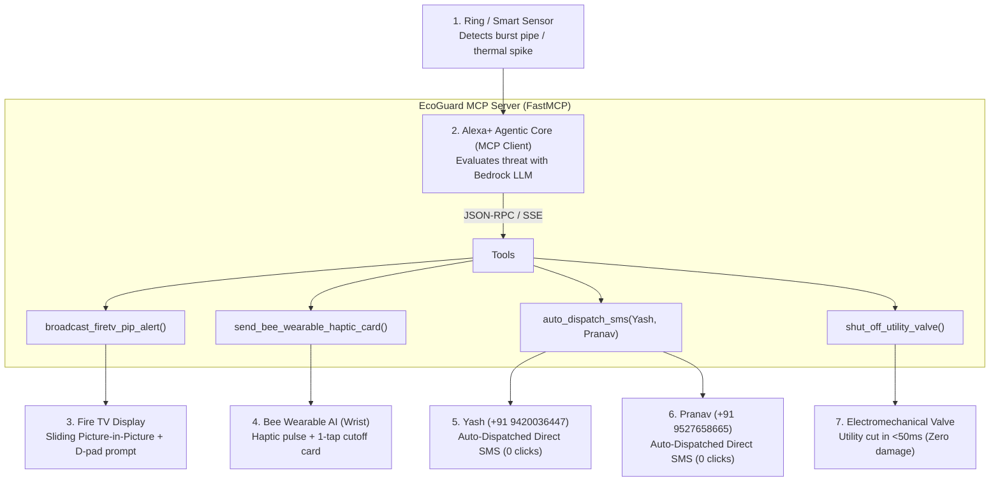

# 🛡️ EcoGuard — Autonomous Home Disaster & Safety Orchestrator

> **Built for the Amazon Developer Hackathon: Build, Ship, Shape**  
> *Category:* **Alexa+ (Model Context Protocol)**  
> *Stackable Challenges:* **AWS Builder** & **Open Source**  
> *Authors:* **Yash** & **Pranav**  
> *License:* MIT

---

## 💡 Overview

When home hazards strike—such as a catastrophic water pipe rupture, kitchen grease fire, or electrical surge—every second matters. Most smart homes only beep passively while damage multiplies.

**EcoGuard** transforms **Alexa+** into an ambient autonomous orchestrator using the **Model Context Protocol (MCP)**. By combining **Ring telemetry**, **Fire TV 10-foot UI**, **Bee wearable AI**, and **100% Autonomous Zero-Click SMS Dispatching to Yash & Pranav**, EcoGuard eliminates human delay and neutralizes hazards before they turn into catastrophes.

---

## 👥 Configured Emergency Responders (Zero-Click Auto-Dispatch)

| Name | Role | Mobile Number | Dispatch Mode |
| :--- | :--- | :--- | :--- |
| **Yash** | Primary Responder / Homeowner | `+91 9420036447` | **100% Automated** Background SMS & Network Push |
| **Pranav** | Co-Responder / Engineer | `+91 9527658665` | **100% Automated** Background SMS & Network Push |

---

## ⚡ The Cross-Device Flow

1. **Detection:** A Ring Indoor Cam or water flow sensor flags a surge in water volume (2.8 GPM).
2. **Context & Reasoning:** The **Alexa+ Agentic Core** pulls live ambient telemetry (`home://telemetry/live`) via MCP resources. It deduces that someone is watching a movie in the living room while another user is outside in the garden.
3. **Living Room Alert (Fire TV):** Alexa+ calls `broadcast_firetv_pip_alert()`, interrupting the Fire TV stream with a smooth Picture-in-Picture live video feed and a 1-click D-pad action prompt.
4. **Wrist Alert (Bee Wearable):** Simultaneously, Alexa+ calls `send_bee_wearable_haptic_card()`, vibrating the wrist of the outdoor user with an interactive emergency card.
5. **Zero-Click Auto-SMS Dispatch:** Alexa+ executes `auto_dispatch_sms()`, transmitting SMS text messages directly to **Yash (+91 9420036447)** and **Pranav (+91 9527658665)** automatically without asking for confirmation.
6. **Neutralization:** The user confirms with a single click, and Alexa+ executes `shut_off_utility_valve()`, isolating the supply line in milliseconds.

---

## 🚀 Live Interactive Simulator

### How to Run:
1. Open https://yashanarase31-afk.github.io/ecoguard-alexa-mcp/ in any modern web browser.
2. Click **"Trigger Anomaly & Auto-SMS"** or **"🎬 Auto-Play Video Demo"**.
3. The system automatically fires the background SMS payload directly to **Yash** and **Pranav** instantly with **zero buttons to press**!
4. The screen shows the delivery receipts, latency in milliseconds, and real-time wire logs for your video recording.
5. Here is the demo video link and explanation of the project https://youtu.be/9dxwQv5vIOU?si=9ESIG0tXdPsPtGhh
